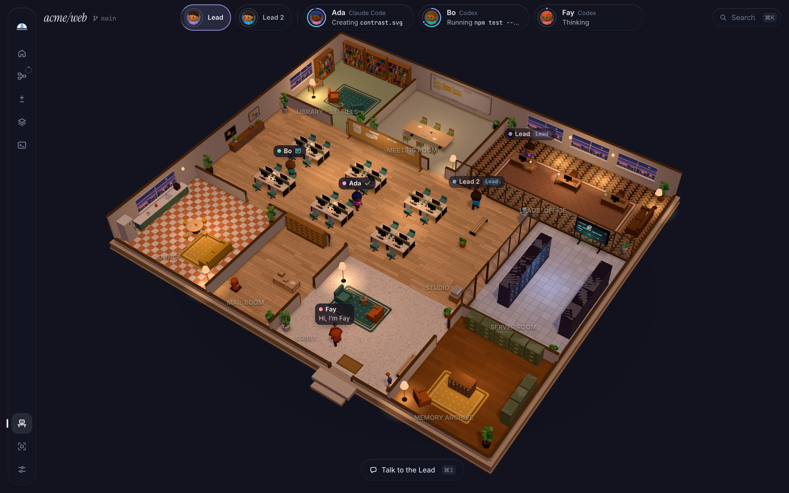

# Codly

**A team of coding agents, one living office.**

[](https://cdn.jsdelivr.net/gh/jwuthri-cloud/Codly@ed48fc5f4c9288d5e500d73756b29836b638e716/docs/media/codly-tour.mp4)

▶ [Watch the 3-minute tour](https://cdn.jsdelivr.net/gh/jwuthri-cloud/Codly@ed48fc5f4c9288d5e500d73756b29836b638e716/docs/media/codly-tour.mp4): ask the Lead, run its plan, approve, merge, and
start a long-term agent of your own.

Codly turns the coding CLIs you already pay for (Claude Code, Codex, Gemini CLI and OpenCode) into one
team on your Mac. A Lead agent plans the work, each agent builds in its own git worktree, and nothing
lands on your branch until you merge it. It is a macOS app built with Tauri, Svelte and Rust.



## Why

Running several coding agents in one repo gets messy fast. They step on each other's files, you lose
track of who is doing what, and every approval is a prompt in a separate terminal. Codly puts them
under one supervisor and shows the same events in two synchronized views:

- **Workspace**: chat with the Lead or talk 1:1 with any agent. Per-agent timeline, shared board, task
  dependency graph, diffs, terminals, and an approvals inbox.
- **World**: a three.js office. Agents walk to the library to search, to the server room to run tests,
  and raise a hand when they need you. Every motion comes from a real event.

## Screenshots

These come from the built-in demo: a fake `acme/web` repo with a scripted team.

### The Lead proposes a plan

Describe the goal to the Lead. It reads the repo read-only and either answers or proposes a small plan:
tasks, dependencies, the agent for each task, and any assumptions it made. You run it, change it or
cancel it.


### Follow the plan as it runs

The plan room lists every task with its checks and the files it may write. A task that depends on
another waits until that one is merged.


### Review finished work

Each finished task shows the verify command that ran, the size of the diff, and the integration branch it
merged into. Agents can ask the Lead a question mid-task, and the answer comes back into the thread.


### Approve what matters

Commands an agent wants to run arrive in one approvals inbox. Codly checks each request against its rules
first (here: it deletes files, stays inside the agent's worktree, and makes no network calls), then asks
you. Approve once, allow for the session, or deny. For a command you trust, or a tool of an MCP server,
choose "Always allow in this repo": Codly then stops asking every agent in that repo about it (never about
deletes, `git push`, `sudo`, secrets or paths outside the worktree), and Settings lists the rules so you
can remove them.


## How it works

1. **Ask the Lead.** It reads the repo read-only and either answers or submits a task plan. Each request
   has a mode: Ask (answers only), Plan (you press Run plan), Auto (plans and runs) or Direct (hands the
   work straight to a team member or consultant). Tasks go to your standing team or to a consultant the
   Lead hires for one task.
2. **Validate and run.** Codly checks the plan for cycles and for two tasks writing the same files at once.
   You click **Run plan**.
3. **Work in isolation.** Each task runs in its own git worktree and branch. The worker gets a pointer pack
   of the relevant code and the team's memory.
4. **Land the work.** When a worker finishes, Codly commits, re-runs the verify commands, checks the write
   scope, optionally asks a reviewer from another vendor, and merges into the plan's integration branch.
   Agents never commit on their own.
5. **You merge.** Review the diff and merge it into your branch. Codly pushes your branch only when you
   press Push. For a review on GitHub, **Create pull request** pushes the plan's branch and opens a pull
   request with a title and a description drafted from the plan, which you can edit first.

Agents coordinate through Codly's MCP tools, so every exchange is typed, validated and visible. Every
agent gets `codly_get_task`, `codly_board`, `codly_search`, `codly_memory_search`, `codly_memory_write`,
`codly_kg_query`, `codly_kg_add` and `codly_post_note`. The Lead adds `codly_submit_plan`,
`codly_message_member`, `codly_quick_task` and `codly_reassign`. Workers add `codly_submit_report` and
`codly_ask_lead`. Reviewers get `codly_submit_review`. The Lead and workers can also raise
`codly_ask_user` to ask you a decision.

## Supported agents

| Agent       | How Codly talks to it                                                                  |
| ----------- | -------------------------------------------------------------------------------------- |
| Claude Code | `claude` in stream-JSON mode, with the stdin control protocol for approvals and interrupts |
| Codex       | One `codex app-server` per agent (JSON-RPC over stdio): live command output, real approvals |
| Gemini CLI  | ACP (`gemini --acp`)                                                                   |
| OpenCode    | ACP (`opencode acp`)                                                                   |

Cursor and Copilot use the same ACP adapter, but they are less tested.

## First run

A short onboarding quest line checks which agent CLIs are installed, offers a visible "Run it for me"
install terminal for the missing ones, and walks you through setting up a Lead, a crew and a first
mission.

Approvals have four modes: balanced, strict, autonomous and Full access (auto-approves everything except
a few hard floors; off unless you choose it). Autonomous is a list of risky commands, not a sandbox: see
[What an agent's commands can do](#subscriptions-and-safety). Settings also holds Triggers (schedules and
network mode) and Inbound (webhook sources for the Lead; Slack is not available yet).

## Requirements

- macOS 14 or later
- At least one agent CLI, installed and signed in

## Install

### Download

Coming with the first release: there is no download yet. Until a release is on the
[Releases page](https://github.com/jwuthri-cloud/Codly/releases), build Codly from source (below).

When a release is there:

1. Download the `.dmg` for your Mac. The name ends in `_aarch64.dmg` for Apple Silicon (M1 and
   later) and in `_x64.dmg` for Intel.
2. Open it and drag Codly to Applications.
3. Open Codly.

If the release notes say the build is not signed with an Apple Developer ID, macOS stops the first
open and says it could not check Codly for malware. This means Apple has not checked this build and
macOS cannot tell you who made it; it does not mean something was found. To open it: close the
message, open System Settings → Privacy & Security, scroll down and choose Open Anyway next to the
line about Codly, then Open. Do this right after the first try: the button is there only for a
while. macOS asks once for each version you download.

To check that a download is the file of the release, download `SHA256SUMS.txt` from the same
release into the same folder and run:

```bash
shasum -a 256 -c --ignore-missing SHA256SUMS.txt   # prints "OK" after the file name
```

Codly does not update itself yet: for a newer version, download it again.

### Build from source

You need Rust 1.90+, Node 22+ and pnpm.

```bash
pnpm install
pnpm tauri dev              # run the desktop app from the checkout
scripts/install-app.sh      # or build Codly.app and put it in /Applications
```

Other useful commands:

```bash
pnpm dev                    # the UI alone in a browser, on a scripted demo session
pnpm test                   # frontend tests (Vitest)
pnpm check                  # svelte-check and TypeScript
cargo test --workspace      # core tests; adapters replay captured CLI transcripts
pnpm tauri build            # build the macOS app and .dmg
```

To use Codly from a browser instead of its window, run the app with `serve`:

```bash
/Applications/Codly.app/Contents/MacOS/codly serve   # prints a link with a token; --port N
```

It runs without a window or Dock icon until Ctrl+C. Run while the app is already open,
the open app serves too and opens the link in your browser.

`codly serve` listens on this Mac only (127.0.0.1). The page can open terminals and control your
agents, and the traffic is plain HTTP, so to reach it from another machine use an SSH tunnel:
`ssh -L 4280:127.0.0.1:4280 <this Mac>`, then open the link on that machine. `--host <address>`
with an address other machines can reach is refused unless you add `--allow-remote`; the link
then works for anyone on your network until Codly stops. Quit the app first: an app that is
already open does not serve to the network. `codly --help` lists every command and
`codly --version` prints the version.

## Develop

Before you push, run the checks that CI runs:

```bash
scripts/verify.sh           # pnpm check, pnpm test, pnpm build, cargo test --workspace
```

It also fails when the tests rewrite `src/lib/gen`: those TypeScript types are generated from the
Rust types by `cargo test`, so commit them with the change that needs them.

CI (`.github/workflows/ci.yml`) runs the same script on Linux for every pull request and every
push to `main`, and compiles the workspace on macOS. To run it on Linux yourself, install the
system packages the workflow lists.

## Troubleshooting

Settings → General → Troubleshooting collects what a bug report needs: the Codly version, your
system, your agent CLIs and the last log lines. Tokens, keys, email addresses and paths under your
home folder are taken out. Repository and agent names can remain: read it, then paste it in the
issue. The same button is on the “Codly couldn’t start” screen.

The log file is `~/Library/Application Support/dev.codly.desktop/logs/codly.log` (at most 5 MB;
the file before it is `codly.1.log`). An internal error (a panic) writes its place and backtrace
there. To log more, start Codly with `CODLY_LOG=debug`: the file then also takes Codly's own
debug lines (those of the libraries it uses go to the terminal only).

## Project layout

- `crates/codly-core/`: the engine, with no Tauri dependency. Orchestrator (Lead, team, planner, scheduler,
  merge queue, approval broker, triggers), agent adapters, SQLite store, git, code index, memory, inbound
  sources and the MCP server.
- `src-tauri/`: the macOS shell (Tauri 2) that hosts the engine, and `codly serve` (the same UI in a
  browser).
- `src/`: the Svelte 5 UI: the Workspace, the World (`src/office/`, three.js), the neighbourhood map
  (`src/world/`), Settings (`src/overlays/`) and onboarding.
- `public/`: the office's furniture models and sounds. These are third-party assets (CC0 and CC BY);
  each folder has its licence or credits file.
- `site/`: the landing page and the live demo build.
- `scripts/`: `install-app.sh` builds Codly.app and installs it in /Applications; `kaykit-clips.py`
  converts animation clips for the World.
- `voice/`: experimental and optional. A Python relay that lets you talk to an agent out loud through
  OpenAI Realtime, used only by `codly serve`. Its start script needs the author's own OpenAI workload
  identity, so nobody else can run it as it is. Without the relay everything else works; a voice call
  fails with "the voice relay is not running".
- `research-skills/`: optional skills for research work. They are not part of the app; you install them
  by hand with `research-skills/install.sh`.
- `docs/`: architecture, design notes and the research behind them.

The full code map is in [docs/ARCHITECTURE.md](docs/ARCHITECTURE.md), section 8.

## Subscriptions and safety

**Your sign-ins and keys**

- Codly spawns the unmodified CLIs you installed and signed in to. It does not proxy them. To see who is
  signed in, it runs the CLI's own status command (Claude Code, Codex) or reads the CLI's settings file
  (Gemini: the sign-in method and the account email, no token).
- Codly does not read your CLIs' sign-in tokens, with one exception that is off until you turn it on:
  **Show Claude usage before an agent runs** (Settings → Accounts). With it on, each time Codly checks
  your sign-ins it reads the Claude Code sign-in token (from the Keychain, or from the sign-in's
  `.credentials.json` file) and sends it to `api.anthropic.com` to ask for your usage, as `/usage` does.
  Codly does not store or log the token. Check Anthropic's terms first: they may not allow another app to
  use this token. With it off, a sign-in shows its usage once an agent has run on it.
- Keys that you give to Codly are stored in the macOS Keychain, not in Codly's settings or database: your
  own API keys (Settings → API keys; each one goes to one CLI only), the Groq key for dictation, webhook
  secrets, and the keys of the tool servers you switch on for agents.
- Each agent shows a billing badge (subscription, API key or third party). API-key variables that would
  silently switch billing are removed from agent environments, unless you turned on your own API key for
  that vendor.
- The same goes for the variables that give Claude Code another sign-in than `claude auth login`:
  `CLAUDE_CODE_USE_BEDROCK`, `CLAUDE_CODE_USE_VERTEX` and `CLAUDE_CODE_OAUTH_TOKEN` (a token from
  `claude setup-token`). Codly removes them from agent environments unless you turn on **Use my shell's
  Claude sign-in** (Settings → Safety). With it on, Claude agents keep them from your login shell, as
  Claude Code does in your terminal, and that account pays. Codly does not store the token. Check
  Anthropic's terms before you use a subscription token this way. Every other `CLAUDE_CODE_*` variable
  is always removed, so that an agent never takes itself for a part of the Claude Code session that
  started Codly.

**Your repository**

- Codly commits and merges by itself only on its own `codly/…` branches: a task's branch, then the
  plan's integration branch after the task's checks pass.
- Codly's commit of an agent's work leaves out a new folder with more than 2,000 files and a new file
  over 25 MB (build output or a dependency folder that the repository does not ignore). The task says
  what was left out, its worker is asked once to ignore it, delete it or stage it (`git add`) as work
  before the checks run, and the files stay in the worktree. Checkpoints leave the same paths out.
  Every commit Codly makes says it in the same way, also the one before a merge, a push or a pull
  request of a solo agent's branch. When no worker turn follows (you re-run a task's checks or merge
  it anyway), the task goes on without the files, and the Lead tells you when **Lead follow-ups** is on.
- Codly changes your branch only when you press a button: **Merge** (a plan's integration branch, or one
  agent's branch, into the branch you have checked out), **Commit** (your own uncommitted changes) and
  **Push** (the branch you have checked out, to its remote, through your own SSH agent).
- Before a merge writes to your branch, Codly keeps the branch as it was under the ref
  `refs/codly/before-merge` in your repository, until the next merge. **Undo merge** takes the last merge
  back while nothing was committed or pushed after it. Before you merge, a plan's card says how many
  commits the plan is behind your branch.
- **Create pull request** pushes one of Codly's own `codly/…` branches (a plan's, or one agent's), never
  a branch of yours and never with force. It asks first and names the remote, the branch and the base.
  Your own `gh` opens the pull request with its sign-in: Codly stores no GitHub token. Without `gh` you
  can still push the branch and open the compare page in your browser. A Codly branch starts from your
  branch: when yours has commits that the remote does not have yet, they go with the push, and the
  dialog says how many before you confirm.
- One kind of agent edits your project folder directly: an agent that you hire with **Git isolation**
  switched off. The hire screen warns you about it. A command that can lose work in your folder (a
  history rewrite, `git reset --hard`, `git clean`, a force push, `rm -rf` outside the build
  folders) asks you first in every approval mode, Full access included: from that agent, and from
  any agent that points such a command at your folder from its worktree.
- A repo's own agent configuration (Claude Code project settings with hooks or allow rules, project
  MCP servers, and the like for the other CLIs) loads only after you trusted the folder. Codly asks
  when it opens such a repo and again when those files change. Until then Claude Code starts
  without them, and a CLI that Codly cannot start without them (Gemini CLI, OpenCode, Cursor) is not
  started in that repo: it takes no task and reviews none. A worktree whose files are not the ones
  of your folder (an agent changed them there) is shown with its own files, to trust by itself.
  The choice is about the repo's files, not yours: a Codex agent starts the MCP servers of your own
  Codex config in every folder, trusted or not. To keep them out, turn off "Use my own CLI setup" in
  Settings.
- An agent that wants to run `git push` itself must ask you first, in every approval mode except Full
  access, which approves it. That holds with **Sandbox Claude's shell** on too (below).
- By itself, Codly removes a worktree only when it is clean and merged, and deletes a `codly/…` branch
  only when its work is merged and its plan has been over for a day. Work that is not committed or not
  merged stays until you delete it in **Settings → Storage**, which first names what you would lose.
  Raw logs of agent runs are deleted after 30 days; you can change that there too.
- A new worktree gets copies of files that git ignores and an agent needs: `node_modules`, `.venv`,
  `venv` and the `.env` files at the top of the repo, plus what a `.worktreeinclude` file at the top of
  the repo lists (same syntax as `.gitignore`). Codly copies a file only when git ignores it in your
  checkout and in the new worktree too, so that it stays out of the commits: commit the `.gitignore`
  line first, or the task says that the file was not copied. To copy one file from a folder that git
  ignores as a whole, write its path (`secrets/dev.env`), not only its name. Codly remembers what it
  copied into each worktree: on a branch that does not ignore a copy, its commit leaves the copy out
  and says so. The worker is then asked for the `.gitignore` line only, never to delete or commit the
  copy.
- To try work before you merge it, a finished plan and a solo agent's Git tab have **Run…** and **Open
  in terminal**. Run… runs a command you type (for example `pnpm dev --port $CODLY_PORT_BASE`) in that
  worktree and shows its output. Codly keeps your last command for the repo and never picks one for
  you. The command ends when you press Stop, when you merge that work, or when you quit Codly. In a
  solo agent's worktree, a file the command writes becomes part of the agent's work unless git
  ignores it.
- A repo can have a setup script, `.codly/setup.sh`, that Codly runs once in each new worktree (to
  install packages, or to write the worktree's own ports from `$CODLY_PORT_BASE` into a local env
  file). It is off until you turn it on in Settings → Safety, which shows you the script. Codly runs
  only the text you turned on: if the file changes, it asks you again. It runs a copy of that text
  in the worktree's top folder, with the program its first line names (`#!/usr/bin/env bash`) or
  `/bin/sh`: use paths from that folder, or `$CODLY_REPO_PATH` for your checkout, not the script's
  own place (`$0`). The script is not sandboxed.
- You decide what passes. Write the commands that must pass in `.codly/checks`, one on each line
  (`pnpm check`, `pnpm test`), and turn them on in Settings → Safety → Required checks, which shows
  them. Codly then runs them for every task, after the checks the Lead wrote, and again on every
  finished plan; **Check the work**, in the Git tab of an agent you chat with, runs them on that
  agent's work. Codly runs only the text you turned on: if the file changes, tasks wait until you read
  it again, and go on by themselves once you turn it on again or off. A plan card also marks a task
  whose own checks cannot fail (`true`, `test -f …`).
- Before each turn of an agent, Codly keeps the files of the agent's worktree as a checkpoint (a commit
  under a private ref, on no branch). **Restore files to this point**, in the agent's Git tab, puts the
  files back and can be undone. It changes files only: the agent still remembers its later turns. An agent
  with Git isolation off has no checkpoints, because Codly never puts files back in your own folder.
  **Restore this file** puts one file of a checkpoint back and leaves the others. **Last turn**, in the
  Git tab and on a task's diff in the Changes room, shows only what the last turn changed. A file or
  folder that is too big for a commit is not in a checkpoint either: the Git tab names it, and a restore
  that would write over it is refused.

**What an agent's commands can do**

- The approval rules read the text of a command. They do not see what a script, a test or a program does
  once it runs. So **Autonomous** mode is a list of risky commands, not a sandbox: a command with no risk
  in its text runs without asking, with the rights of your account.
- Codex agents always run in Codex's own OS sandbox, which keeps their writes in their worktree.
- Claude Code agents have no OS sandbox, unless you turn on **Sandbox Claude's shell** (Settings →
  Safety; off by default). With it on, Claude Code runs the shell commands of workers and 1:1 agents in
  its own OS sandbox:
  - A sandboxed command can write only in the agent's folder (its worktree), a temporary folder and the
    repository's git data. It can still read your other files.
  - It can reach only the hosts that your Claude Code settings allow. Codly adds no host and no folder.
    When a command wants another host, Codly asks you, in every approval mode except Full access: the
    approval card names the host. If you allow it, the host stays allowed for the rest of that agent's
    session, for every later command. If you deny it, the command gets a network error.
  - Commands still go through the approval rules, as they do with the switch off: what the rules ask
    about (a `git push`, an `rm -rf`, a download) still asks you first. The sandbox is a second check
    under the rules, not a way around them. So one command can ask twice: once for itself, and once
    for a host it wants.
  - A command that Claude wants to run outside the sandbox asks you first, in every approval mode except
    Full access. The approval card says that it runs outside the sandbox.
  - When an agent starts, Codly asks Claude Code whether its sandbox is really on. If it is not (your
    system cannot run it, or a setting of your organization changes it), the agent does not start
    and Codly tells you why.
  - The sandbox covers shell commands only. File edits and tool servers (MCP) are not sandboxed: they go
    through approvals as before. Codly's own checks (a task's verify commands, the setup script) are
    not sandboxed either.
- Gemini, OpenCode, Cursor and Copilot agents have no OS sandbox. For them, and for Claude Code agents
  without the switch, the approval rules are the only check.

**The network**

- There are no Codly servers: no account, nothing to sync. Your CLIs talk to their own providers as
  before.
- Codly itself goes online only to install a CLI or a skill when you click, to fetch the tool servers
  that agents start with (through `npx` or `uvx`), to push when you press Push or Create pull request
  (your `gh` then opens the pull request, and reads its state and checks when you press Refresh), to read
  an issue or a pull request with your `gh` when you start a request from one (**From issue…**, **From
  pull request…**: the Lead gets its text as quoted data, nothing is written to GitHub, and because other
  people write that text, the plans of that request wait for Run plan in every mode until one of them is
  done; the plan's card says why), and for two
  features that
  are off until you turn them on: dictation (audio goes to Groq with your key) and Show Claude usage.
  The voice relay in `voice/` talks to OpenAI, and only if you run it.
- Inbound webhooks listen on this Mac only (loopback) and are created switched off. A webhook message
  shows under its endpoint's name, not as yours, and a plan made from it waits for Run plan unless you
  let that endpoint run plans without asking; the plan's card says why it waits. Until your next
  message, the Lead is also stopped before it messages a team member or reassigns a task. An agent you
  pick to answer webhook messages asks as its approval mode says, whatever trust you gave it, from the
  turn that reads such a message until a turn that your own message to it starts. `codly serve` also
  listens on this Mac only, unless you pass `--host`.

Provider terms change. Check them before heavy parallel use.

## Docs

- [Architecture](docs/ARCHITECTURE.md): decisions, processes, event model, orchestration and memory.
- [Release](docs/RELEASE.md): how a release is built, signed and published, and where the version is set.
- [Browser demo](docs/DEMO.md): the scripted demo behind `pnpm dev`, and the URL parameters that open each screen.
- [Research](docs/research/): the reports behind each decision, and the consolidated
  [critique](docs/research/CRITIQUE.md).

## Status

Early: this is the v0.1 vertical slice. Expect rough edges.
