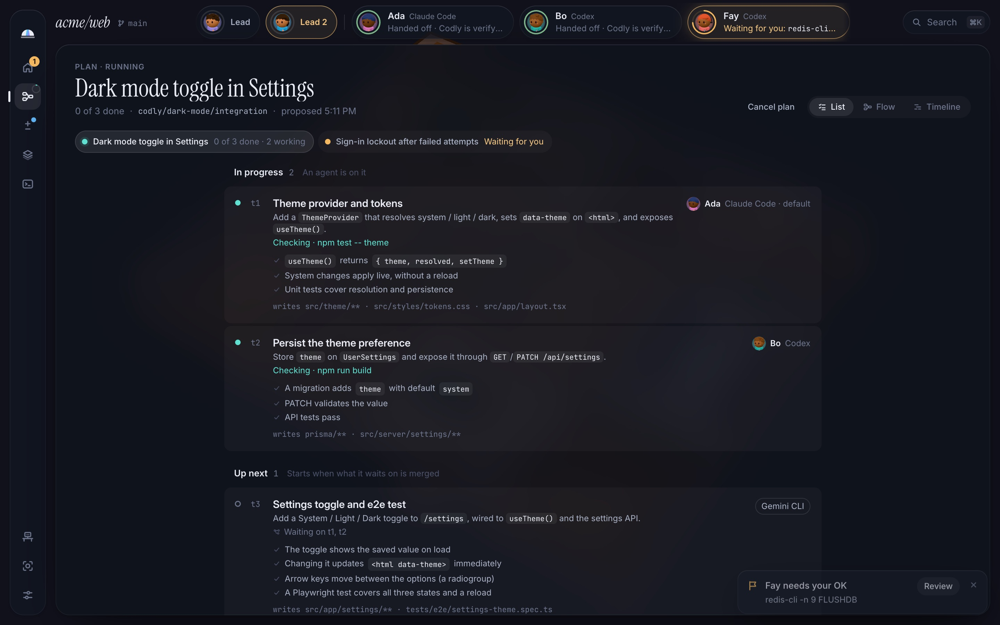
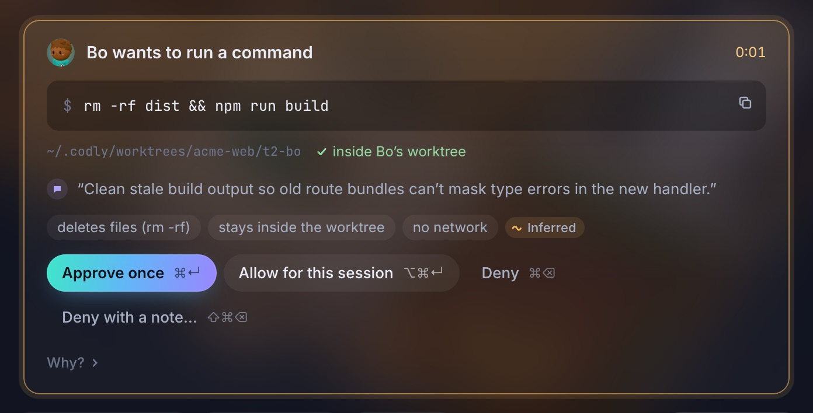

# Codly

**A team of coding agents, one living office.**

[](https://cdn.jsdelivr.net/gh/jwuthri-cloud/Codly@ed48fc5f4c9288d5e500d73756b29836b638e716/docs/media/codly-tour.mp4)

▶ [Watch the 3-minute tour](https://cdn.jsdelivr.net/gh/jwuthri-cloud/Codly@ed48fc5f4c9288d5e500d73756b29836b638e716/docs/media/codly-tour.mp4): ask the Lead, run its plan, approve, merge, and
start a long-term agent of your own.

## What Codly is

Codly runs the coding CLIs you already have (Claude Code, Codex, Gemini CLI and OpenCode) as one
team on your Mac. A Lead agent plans the work. Each worker builds in its own git worktree. Codly
checks the work, can have another agent review it, and merges it into a branch of its own. Nothing
lands on your branch until you press Merge. It is a macOS app built with Tauri, Svelte and Rust.

Running several agents in one repo by hand gets messy: they edit the same files, you lose track of
who does what, and every approval is a prompt in another terminal. Codly puts them under one
supervisor and shows the same events in two views:

- **Workspace**: chat with the Lead or talk 1:1 with any agent. A timeline per agent, a shared
  board, the task graph, diffs, terminals and the approval cards.
- **World**: a three.js office. Agents walk to the library to search, to the server room to run
  tests, and raise a hand when they need you. Every work motion comes from a real event.


Status: early. This is the v0.1 vertical slice. Expect rough edges, and read
[Limits and known gaps](#limits-and-known-gaps) before you point it at a repository you care about.

## Install

You need macOS 14 or later and at least one agent CLI, installed and signed in.

### Download

There is no release yet. Until one is on the
[Releases page](https://github.com/jwuthri-cloud/Codly/releases), build Codly from source (below).

When a release is there:

1. Download the `.dmg` for your Mac. The name ends in `_aarch64.dmg` for Apple Silicon (M1 and
   later) and in `_x64.dmg` for Intel.
2. Open it and drag Codly to Applications.
3. Open Codly.

If the release notes say the build is not signed with an Apple Developer ID, macOS stops the first
open and says it could not check Codly for malware. This means Apple has not checked this build and
macOS cannot tell you who made it; it does not mean something was found. To open it: close the
message, open System Settings → Privacy & Security, scroll down and choose Open Anyway next to the
line about Codly, then Open. Do this right after the first try: the button is there only for a
while. macOS asks once for each version you download.

To check that a download is the file of the release, download `SHA256SUMS.txt` from the same
release into the same folder and run:

```bash
shasum -a 256 -c --ignore-missing SHA256SUMS.txt   # prints "OK" after the file name
```

Codly does not update itself yet: for a newer version, download it again.

### Build from source

You need Rust 1.90 or later, Node (CI uses Node 22) and pnpm.

```bash
pnpm install
pnpm tauri dev              # run the desktop app from the checkout
scripts/install-app.sh      # or build Codly.app and put it in /Applications
```

To look at the UI without building the app, `pnpm dev` serves it in a browser on a scripted demo:
no agent CLI runs and nothing is written to disk. [docs/DEMO.md](docs/DEMO.md) lists the URL
parameters that open each screen.

## First run

The onboarding is a short quest line. It checks which agent CLIs are installed and signed in, offers
**Install for me** (a visible terminal that runs the vendor's install command) for the missing ones,
and walks you through a Lead, a crew and a first request. Then open a repository (⌘O).

## The main flow

These screenshots come from the browser demo: a made-up `acme/web` repo with a scripted team.

### 1. Ask

Write to the Lead. It reads the repo read-only. Each request has a mode, picked under the composer
or with ⇧⇥:

- **Ask**: the Lead only answers.
- **Plan** (the default): the Lead proposes a plan and you press **Run plan**.
- **Auto**: the plan runs at once. **Run plans without asking** in Settings makes Auto the default.
- **Direct**: no plan card; the work goes straight to a team member or a consultant.

You can also start a request from a GitHub issue or pull request (**From issue…**, **From pull
request…** in the `/` menu): your own `gh` reads it. Each request has its own Lead and thread
(⌘N for a new one), so several requests can run side by side.

### 2. Plan

The plan lists tasks, their dependencies, the agent for each task, the files each task may write,
the commands that check it, and the assumptions the Lead made. Codly checks the plan: no cycles,
and two tasks that would write the same files run one after the other. You run it, change it or
cancel it. A task whose checks cannot fail (`true`, `test -f …`) is marked on the card.


### 3. Run

Each task runs in its own git worktree and branch, started from the plan's integration branch. The
worker gets a pointer pack of the relevant code and the team's memory. A task that depends on
another waits until that one is merged. Tasks go to your standing team (set in Settings → Team) or
to a consultant the Lead hires for one task.



### 4. Approve

What an agent wants to do and Codly's rules do not settle comes to you as a card in the
conversation. Codly reads each request against its rules first (for example: it deletes files, it
reaches outside the agent's worktree, it uses the network), then asks you: **Approve once**,
**Allow for this session** or **Deny** (⌘↵, ⌥⌘↵, ⌘⌫; ⇧⌘⌫ denies with a note). A Codex request for
more permissions says in words which folders or network it wants and which are outside its
worktree. Questions an agent asks you come the same way: 1 to 9 pick an option and ⌘↵ sends the
answer. A plan a Claude agent shows you has no plain "no": you send it back with a note, since
without one Claude Code shows the same plan again. What you said with an answer (a note, an
answer, a changed plan) stays on the closed card. See [Safety](#safety) for the approval modes
and the saved rules.



### 5. Review

When a worker finishes, Codly commits its work (agents never commit by themselves), runs the task's
checks again, checks that it wrote only the files it was allowed to, and, if you turned on
**Cross-vendor review before merge**, asks an agent of another CLI to review it. A failure goes back
to the worker to fix. Work that passes merges into the plan's integration branch.

In the Changes room you can read each diff, comment on lines, tick files as viewed, and send a task
back with your comments. **Last turn** shows only what an agent's last turn changed. On a finished
plan that is not merged yet, **Send back** makes your comments one more task of the plan, for the
agent that wrote those files; on merged work it opens a new request with them.


### 6. Merge

A finished plan's card has **Merge into \<your branch\>**. Before you merge you can try the work:
**Run…** runs a command you type (for example `pnpm dev --port $CODLY_PORT_BASE`) in the plan's
worktree, and **Open in terminal** opens a shell there. If your branch moved since the plan
started, Codly first runs the plan's checks on the merge result; if the merge conflicts, **Have an
agent resolve it** gives the plan one more task. **Push to \<remote\>** pushes your branch.
**Create pull request…** pushes the plan's own branch instead and opens a pull request with your
`gh`, with a title and description drafted from the plan that you can edit first.

### 7. Undo

**Undo merge** takes the last merge back while nothing was committed or pushed after it. Before
each turn of an agent Codly keeps a checkpoint of its worktree: **Restore files to this point** (in
the agent's Git tab) puts the files back, and can itself be undone. In a 1:1 chat with an agent
that rests, Esc Esc or `/undo` opens **Undo a turn**: pick one of its turns, and its files go back
to how they were before it.

### Talk to one agent

Besides requests to the Lead, you can hire a long-term 1:1 agent and chat with it, as in its own
CLI. **Quick start with …** on the add-agent wizard's first step, or "Start an agent with …" in the
palette (⌘K), starts one with the CLI's defaults. It works in its own worktree (or, with **Git
isolation** off, in your project folder), and its Git tab has merge, push, pull request and
checkpoints. The composer's `/` menu has the agent's controls, as its CLI's slash commands do:
compact, context, mode, model, undo the last turn, your terminal, its MCP servers. For a Claude
Code agent ⇧⇥ switches its mode (ask for edits, accept edits, plan first), and a mode or model
change needs no restart. Its sheet lists its MCP servers with Reconnect, **Turn off** and **Turn
on**, and its background commands and helpers (subagents) with **Stop**. Codly opens on the
request you left. When you come back to a conversation, one row before the first new one says what
came while you were away. **Open in my
terminal** hands a Claude Code agent's session to your terminal (`claude --resume`), and **Give it
back** returns it to Codly.

### How agents talk to Codly

Agents coordinate through Codly's own MCP tools, so every exchange is typed, checked and visible.
Every agent gets `codly_get_task`, `codly_board`, `codly_search`, `codly_memory_search`,
`codly_memory_write`, `codly_kg_query`, `codly_kg_add` and `codly_post_note`. The Lead adds
`codly_submit_plan`, `codly_message_member`, `codly_quick_task` and `codly_reassign`. Workers add
`codly_submit_report` and `codly_ask_lead`. Reviewers get `codly_submit_review`. The Lead and
workers can also use `codly_ask_user` to ask you a decision.

## Long runs and restarts

- **Keep the Mac awake while agents work** (on by default): the Mac does not go to sleep by itself
  while an agent works or a plan runs. It may sleep when all work waits for you. Closing the lid
  still puts it to sleep.
- **Ask before quitting while agents work** (on by default). Agents are child processes of Codly:
  they stop when it quits.
- **Resume work when Codly opens** (Ask by default): work that was under way when Codly closed does
  not go on by itself. A bar at the top asks once: **Resume work** or **Not now**; until you
  resume, no task starts, also after a pause or a budget ends. Always and Never are the other
  choices.
- Silent agents: a turn with no output for 10 minutes is flagged and you are notified; at twice
  that, the turn is interrupted once; after as long again, the run is stopped. A tool call that
  gives no sign of life gets 60 minutes; Claude Code says every 30 s that a command, an MCP tool
  or a helper still runs, so a hung one of those is noticed after 10. Settings → Safety → Limits
  sets the times.
- A worker turn that fails is retried after a wait; at its third failure in a row the task is
  blocked with the error, and **Retry** is on the row that says so. A plan that cannot go on says
  so in its thread.
- Notifications (Settings → General → Notifications): one switch per kind, and by default only
  while Codly is not in front.
- Budgets (Settings → Safety → Limits): a token budget and a cost budget for all agents
  together, both off by default. A used-up budget stops new work; it never kills an agent.

## Safety

### Approval modes and saved rules

Settings → Safety → Approvals has four modes:

| Mode | What asks you |
| --- | --- |
| Balanced (default) | Codly's rules settle the obvious cases; what has a risk (`rm -rf`, `git push`, a path outside the worktree, a network install) asks you. |
| Ask first | Every command and edit the CLI would ask about. |
| Autonomous | Only what Codly sees a risk in. |
| Full access | Nothing about commands or edits, risky ones included, except a few hard floors (below). |

In Full access these still ask: an agent's questions, a plan an agent shows you, permission
changes, changes to an agent's own CLI settings, writes to Codly's own data, anything from a read-only agent, and a command that can
lose work in your project folder itself (a history rewrite, `git reset --hard`, `git clean`, a force
push, `rm -rf` outside the build folders).

The rules read the text of a command. They do not see what a script, a test or a program does once
it runs. So Autonomous is a list of risky commands, not a sandbox: a command with no risk in its
text runs without asking, with the rights of your account.

For a command you trust, or a tool of an MCP server that a Claude Code agent asks for, choose
**Always allow in this repo** on its card: Codly then stops asking every agent in that repo about
it. A rule never covers deletes, `git push`, `sudo`, secrets, paths outside the worktree or a
command that can lose work in your project folder.
Settings → Safety → Approvals lists the rules so you can remove them.

### OS sandboxes

- Codex agents always start in Codex's own OS sandbox (`workspace-write`), which keeps their
  writes in their working folder (its worktree) and a temporary folder. A command that Codex wants
  to run outside the sandbox asks first, and the approval rules decide it like any other request:
  Full access approves it. The sandbox's network is closed unless you turn on **Let Codex agents
  use the network** (Settings → Safety → Sandbox; off by default). With it on, a command that needs
  the network (a `git push`, a download) runs inside the sandbox without asking, so the approval
  rules do not see it.
- Claude Code agents have no OS sandbox, unless you turn on **Sandbox Claude's shell** (Settings →
  Safety → Sandbox; off by default). With it on, Claude Code runs the shell commands of workers
  and 1:1 agents in its own OS sandbox:
  - A sandboxed command can write only in the agent's folder (its worktree), a temporary folder and
    the repository's git data. It can still read your other files.
  - It can reach only the hosts that your Claude Code settings allow. Codly adds no host and no
    folder. When a command wants another host, Codly asks you, in every approval mode except Full
    access: the approval card names the host. Approve once lets this command connect. Claude Code
    then does not ask again for this host while this agent keeps running. When the agent starts
    again (Codly restarts, or a change that restarts the agent) it asks again. If you deny it, the
    command gets a network error.
  - Commands still go through the approval rules, as they do with the switch off: what the rules
    ask about (a `git push`, an `rm -rf`, a download) still asks you first. The sandbox is a second
    check under the rules, not a way around them. So one command can ask twice: once for itself,
    and once for a host it wants.
  - A command that Claude wants to run outside the sandbox asks you first, in every approval mode
    except Full access. The approval card says that it runs outside the sandbox.
  - When an agent starts, Codly asks Claude Code whether its sandbox is really on. If it is not
    (your system cannot run it, or a setting of your organization changes it), the agent does not
    start and Codly tells you why.
  - The sandbox covers shell commands only. File edits and tool servers (MCP) are not sandboxed:
    they go through approvals as before. Codly's own checks (a task's verify commands, the setup
    script) are not sandboxed either.
- Gemini, OpenCode, Cursor and Copilot agents have no OS sandbox. For them, and for Claude Code
  agents without the switch, the approval rules are the only check.

### Folder trust

A repo's own agent configuration (Claude Code project settings with hooks or allow rules, project
MCP servers, and the like for the other CLIs) loads only after you trusted the folder. Codly asks
when it opens such a repo and again when those files change. Until then Claude Code starts without
them, and a CLI that Codly cannot start without them (Gemini CLI, OpenCode, Cursor) is not started
in that repo: it takes no task and reviews none. A worktree whose files are not the ones of your
folder (an agent changed them there) is shown with its own files, to trust by itself. A choice
counts from an agent's next start: a Claude run that started without the folder's files says so
in its record, and goes on without them until the agent starts again.

The choice is about the repo's files, not yours: a Codex agent starts the MCP servers of your own
Codex config in every folder, trusted or not. To keep them out, turn off **Use my own CLI setup**
(Settings → General → Plans).

Text that other people write is never taken as yours: a webhook message, or the issue or pull
request a request starts from, reaches the Lead as quoted data, and the plans made from it wait for
**Run plan** in every mode. The plan's card says why it waits.

### What Codly never does without you

- Codly commits and merges by itself only on its own `codly/…` branches: a task's branch, then the
  plan's integration branch after the task's checks pass.
- It changes your branch only when you press a button: **Merge** (a plan's integration branch, or
  one agent's branch, into the branch you have checked out), **Commit** (your own uncommitted
  changes) and **Push** (the branch you have checked out, to its remote, through your own SSH
  agent).
- Before a merge writes to your branch, Codly keeps the branch as it was under the ref
  `refs/codly/before-merge` in your repository, until the next merge. Before you merge, a plan's
  card says how many commits the plan is behind your branch.
- **Create pull request** pushes one of Codly's own `codly/…` branches (a plan's, or one agent's),
  never a branch of yours and never with force. It asks first and names the remote, the branch and
  the base. Your own `gh` opens the pull request with its sign-in: Codly stores no GitHub token.
  Without `gh` you can still push the branch and open the compare page in your browser. A Codly
  branch starts from your branch: when yours has commits that the remote does not have yet, they go
  with the push, and the dialog says how many before you confirm.
- An agent that wants to run `git push` itself must ask you first, in every approval mode except
  Full access, which approves it, and no saved rule covers it. That holds with **Sandbox Claude's
  shell** on too. One exception: with **Let Codex agents use the network** on, a Codex agent's push
  runs inside its sandbox without a request.
- One kind of agent edits your project folder directly: an agent that you hire with **Git
  isolation** switched off. The hire screen warns you about it. A command that can lose work in
  your folder asks you first in every approval mode, Full access included: from that agent, and from
  any agent that points such a command at your folder from its worktree. Such an agent has no
  checkpoints, because Codly never puts files back in your own folder.
- By itself, Codly removes a worktree only when it is clean and merged, and deletes a `codly/…`
  branch only when its work is merged and its plan has been over for a day. Work that is not
  committed or not merged stays until you delete it in **Settings → General → Storage**, which first
  names what you would lose. Raw logs of agent runs are deleted after 30 days. Storage also has the
  switch for this cleanup and the number of days for logs.

### What Codly commits, copies and runs

- Codly's commit of an agent's work leaves out a new folder with more than 2,000 files and a new
  file over 25 MB (build output or a dependency folder that the repository does not ignore). The
  task says what was left out, its worker is asked once to ignore it, delete it or stage it
  (`git add`) as work before the checks run, and the files stay in the worktree. Checkpoints leave
  the same paths out.
- A new worktree gets copies of files that git ignores and an agent needs: `node_modules`, `.venv`,
  `venv`, `.env`, `.env.local`, `.env.development.local` and `.env.test.local` at the top of the
  repo, plus what a `.worktreeinclude` file at the
  top of the repo lists (same syntax as `.gitignore`). Codly copies a file only when git ignores it
  in your checkout and in the new worktree too, so that it stays out of the commits. Each worktree
  gets its own block of ports in `$CODLY_PORT_BASE`.
- A repo can have a setup script, `.codly/setup.sh`, that Codly runs once in each new worktree (to
  install packages, or to write the worktree's ports into a local env file). It is off until you
  turn it on in Settings → Safety → Worktrees, which shows you the script. Codly runs only the
  text you turned on: if the file changes, it asks you again. Use paths from the worktree's top
  folder, or `$CODLY_REPO_PATH` for your checkout. The script is not sandboxed.
- You decide what passes. Write the commands that must pass in `.codly/checks`, one on each line
  (`pnpm check`, `pnpm test`), and turn them on in Settings → Safety → Checks, which shows
  them. Codly then runs them for every task, after the checks the Lead wrote, and again on every
  finished plan; **Check the work**, in the Git tab of an agent you chat with, runs them on that
  agent's work. If the file changes, tasks wait until you read it again.
- The Lead's verify commands go through the same risk rules: one with a risk waits for your OK on
  its task. A check runs for at most 10 minutes by default (Settings → Safety → Checks).

### Your sign-ins and keys

- Codly spawns the unmodified CLIs you installed and signed in to. It does not proxy them. To see
  who is signed in, it runs the CLI's own status command (Claude Code, Codex) or reads the CLI's
  settings file (Gemini: the sign-in method and the account email, no token).
- Codly does not read your CLIs' sign-in tokens, with one exception that is off until you turn it
  on: **Show Claude usage before an agent runs** (Settings → Team → Accounts). With it on, each time
  Codly checks your sign-ins it reads the Claude Code sign-in token (from the Keychain, or from the
  sign-in's `.credentials.json` file) and sends it to `api.anthropic.com` to ask for your usage, as
  `/usage` does. Codly does not store or log the token. Check Anthropic's terms first: they may not
  allow another app to use this token. With it off, a sign-in shows its usage once an agent has run
  on it.
- Keys that you give to Codly are stored in the macOS Keychain, not in Codly's settings or
  database: your own API keys (Settings → Team → API keys; each one goes to one CLI only), the Groq
  key for dictation, webhook secrets, and the keys of the tool servers you switch on for agents.
- Each agent shows a billing badge (subscription, API key or third party). API-key variables that
  would silently switch billing are removed from agent environments, unless you turned on your own
  API key for that vendor.
- The same goes for the variables that give Claude Code another sign-in than `claude auth login`:
  `CLAUDE_CODE_USE_BEDROCK`, `CLAUDE_CODE_USE_VERTEX` and `CLAUDE_CODE_OAUTH_TOKEN` (a token from
  `claude setup-token`). Codly removes them from agent environments unless you turn on **Use my
  shell's Claude sign-in** (Settings → Safety → Trust). With it on, Claude agents keep them
  from your login shell, as Claude Code does in your terminal, and that account pays. Codly does not
  store the token. Check Anthropic's terms before you use a subscription token this way. Every
  other `CLAUDE_CODE_*` variable is always removed, so that an agent never takes itself for a part
  of the Claude Code session that started Codly. (Codly sets one of its own for Claude agents:
  `CLAUDE_CODE_DISABLE_AUTO_MEMORY=1`.)

### The network

- There are no Codly servers: no account, nothing to sync. Your CLIs talk to their own providers as
  before.
- Codly itself goes online only to install a CLI or a skill when you click, to fetch the tool
  servers that agents start with (through `npx` or `uvx`), to push when you press Push or Create
  pull request, to use your `gh` for a pull request (it reads the pull request's state and checks
  only when you press Refresh) or to read an issue or a pull request you start a request from, and
  for two features that are off until you turn them on: dictation (audio goes to Groq with your
  key) and Show Claude usage. The voice relay in `voice/` talks to OpenAI, and only if you run it.
- Inbound webhooks (Settings → Automation) listen on this Mac only (loopback) and are created
  switched off. A webhook message shows under its endpoint's name, not as yours, and a plan made
  from it waits for Run plan unless you let that endpoint run plans without asking. Until your next
  message, the Lead is also stopped before it messages a team member or reassigns a task. An agent
  you pick to answer webhook messages asks as its approval mode says, whatever trust you gave it,
  from the turn that reads such a message until a turn that your own message to it starts.
- `codly serve` also listens on this Mac only; another `--host` needs `--allow-remote` (below).

Provider terms change. Check them before heavy parallel use.

## The CLIs

| CLI | How Codly runs it | What was checked |
| --- | --- | --- |
| Claude Code | `claude` in stream-JSON mode, with the stdin control protocol for approvals, interrupts, mode and model changes | The adapter's tests replay real recordings of Claude Code 2.1.311 (`docs/research/fixtures/claude-2.1.311/`, described in `docs/research/cli-claude-stream-json-2.1.311*.md`). |
| Codex | One `codex app-server` per sign-in (JSON-RPC over stdio), one thread per agent | Recorded live with Codex 0.161 before this release's work. The newer parts (subagents, Compact now, usage read, thread names) are built from the protocol types that codex-cli 0.166.0 generates and were never run live. |
| Gemini CLI | ACP (`gemini --acp --skip-trust`) | Recorded transcripts only; never run live during this release's work. |
| OpenCode | ACP (`opencode acp`) | Recorded transcripts only; never run live during this release's work. |
| Cursor, Copilot | ACP (`cursor-agent acp`, `copilot --acp`) | Never run: not installed on the test machine. |

What works with each:

- Every CLI: plans, tasks, worktrees, the gate, approvals through Codly's broker, Codly's MCP
  tools, merge and pull request.
- Claude Code only: the opt-in OS sandbox, **Open in my terminal**, the mode switch, the MCP
  server list with Reconnect and Turn off / Turn on, Stop for a background command or a helper, and
  saved rules for MCP tools. A message sent mid-turn reaches the agent during the turn.
- Codex: its own OS sandbox, Compact now, usage windows read with its own sign-in, subagents shown
  as rows. A message sent mid-turn reaches it in the turn too.
- Gemini CLI, OpenCode, Cursor and Copilot: no OS sandbox and no take-over to your terminal.
  Gemini CLI, OpenCode and Cursor are not started in a folder whose own CLI files you did not
  trust.

Several sign-ins per CLI are supported (Settings → Team → Accounts); work is spread by quota left
or taken in order.

## Settings

Settings has five tabs: General, Team, Safety, Automation and Developer. The switches whose default
matters most:

| Setting | Where | Default |
| --- | --- | --- |
| Approval mode | Safety → Approvals | Balanced |
| Run plans without asking | General → Plans | Off |
| Lead follow-ups | General → Plans | On |
| Use my own CLI setup | General → Plans | On |
| Keep the Mac awake while agents work | General → Long runs | On |
| Ask before quitting while agents work | General → Long runs | On |
| Resume work when Codly opens | General → Long runs | Ask |
| Office rules affect work | General → Office | Off: the office game never delays, refuses or changes work |
| Keep the office moving behind the chat | General → Office | Off |
| Notifications | General → Notifications | Every kind on, only while Codly is not in front |
| Agents at once | Team | 3 |
| Workers per account | Team → Accounts | 2 |
| Show Claude usage before an agent runs | Team → Accounts | Off |
| Sandbox Claude's shell | Safety → Sandbox | Off |
| Use my shell's Claude sign-in | Safety → Trust | Off |
| Let Codex agents use the network | Safety → Sandbox | Off |
| Cross-vendor review before merge | Safety → Checks | Off |
| Time limit for checks | Safety → Checks | 10 minutes |
| Circuit breaker | Safety → Limits | On; token and cost budgets off |
| Silent agents | Safety → Limits | Flag after 10 min (60 with a silent tool call open), idle after 2 min |
| Webhooks | Automation | Each new endpoint off |

## Keyboard shortcuts

Press `?` in the app for the full sheet. The main ones:

| Keys | Action |
| --- | --- |
| ⌘K | Search and commands; it also finds what was said in this repo's conversations |
| ⌘N, ⌘[ / ⌘] | New request; previous / next request |
| ⇧⌘N | New task |
| ⌘F | Find in the conversation |
| ⌘↵ | Approve once, send a question's answer, or run the plan |
| 1 … 9 | Pick an option of the question that waits |
| ⌥⌘↵ | Allow for this session |
| ⌘⌫, ⇧⌘⌫ | Deny; deny with a note |
| Esc | Close, deselect; Esc Esc stops the running turn, or, in a 1:1 with an agent that rests, opens **Undo a turn** |
| ↑ | Bring back what you sent (on an empty line) |
| @, # | Talk to one agent or mention a file; mention a task |
| ⇧⇥ | Next request mode: Ask, Plan, Auto, Direct; in a 1:1 with Claude, its next mode |
| ⌘1, ⌘2, ⌘3 | Full office, full work, the neighbourhood map |
| ⌘. | Focus: dim the office |
| G then H, P, C, K, T, S | Home, Plan, Changes, Knowledge, Terminal, Settings |
| ⌘O, ⌘, | Open repository; Settings |

## Codly in a browser (`codly serve`)

To use Codly from a browser instead of its window:

```bash
/Applications/Codly.app/Contents/MacOS/codly serve   # prints a link with a token; --port N
```

It listens on 127.0.0.1, port 4280 by default, and runs without a window or Dock icon until Ctrl+C.
Run while the app is already open, the open app serves too and opens the link in your browser.

The page can open terminals and control your agents, and the traffic is plain HTTP. To reach it
from another machine, use an SSH tunnel: `ssh -L 4280:127.0.0.1:4280 <this Mac>`, then open the
link on that machine. `--host <address>` with an address other machines can reach is refused
unless you add `--allow-remote`; the link then works for anyone on your network until Codly stops.
Quit the app first: an app that is already open does not serve to the network. `codly --help`
lists every command and `codly --version` prints the version.

When `codly serve` stops or restarts, the page keeps what it shows, and a bar at the top says
"Codly is not reachable. Trying again…" with the time of the last try. The page tries again after
1, 2, 5 and 10 seconds, then every 10 seconds until Codly is back; **Try now** tries at once. Once
it is back, the page catches up on what happened meanwhile. With `--allow-remote` each start
prints a new link: the page then says it is signed out, and you open the new link. Notifications
show on the Mac that runs Codly, not in the browser.

## Troubleshooting

Settings → General → Troubleshooting collects what a bug report needs: the Codly version, your
system, your agent CLIs and the last log lines. Tokens, keys, email addresses and paths under your
home folder are taken out. Repository and agent names can remain: read it, then paste it in the
issue. The same button is on the "Codly couldn't start" screen.

The log file is `~/Library/Application Support/dev.codly.desktop/logs/codly.log` (at most 5 MB;
the file before it is `codly.1.log`). An internal error (a panic) writes its place and backtrace
there. To log more, start Codly with `CODLY_LOG=debug`: the file then also takes Codly's own
debug lines (those of the libraries it uses go to the terminal only).

## Limits and known gaps

- macOS only. The Linux CI builds and tests the code, but macOS-only code is compiled only by the
  macOS CI job, and the packaged app has not been driven end to end by a test.
- Live CLI runs: Gemini CLI, OpenCode, Cursor and Copilot were not run during the latest work; Codex
  features newer than version 0.161 come from its generated protocol types. See [The CLIs](#the-clis).
- Agents are children of the app. They stop when it quits or the Mac sleeps; a command an agent
  left running with `&` keeps running after its agent stops.
- The approval rules read command text, not what a program does. Only Codex, and Claude Code with
  its switch on, have an OS sandbox.
- **Open in my terminal** works for Claude Code agents only, between turns, and never for the Lead.
- Slack as an inbound source is not connected yet: its settings show "Not available yet".
- `voice/` is experimental. Its start script needs the author's own OpenAI workload identity, so
  nobody else can run it as it is; without it a voice call fails with "the voice relay is not
  running".
- The browser demo has no git, `gh` or shell behind it: diffs, commits and command output there are
  made up.

## Develop

```bash
pnpm dev                    # the UI alone in a browser, on a scripted demo session
pnpm test                   # frontend tests (Vitest)
pnpm check                  # svelte-check and TypeScript
cargo test --workspace      # core tests; adapters replay recorded CLI transcripts
pnpm tauri build            # build the macOS app and .dmg
```

Before you push, run the checks that CI runs:

```bash
scripts/verify.sh           # pnpm check, pnpm test, pnpm build, cargo test --workspace
```

It also fails when the tests rewrite `src/lib/gen`: those TypeScript types are generated from the
Rust types by `cargo test`, so commit them with the change that needs them.

CI (`.github/workflows/ci.yml`) runs the same script on Linux for every pull request and every
push to `main`, and compiles the workspace on macOS. To run it on Linux yourself, install the
system packages the workflow lists.

### Project layout

- `crates/codly-core/`: the engine, with no Tauri dependency. Orchestrator (Lead, team, planner,
  scheduler, gate and merge queue, approval broker, triggers), agent adapters, SQLite store, git,
  code index, memory, inbound sources and the MCP server.
- `src-tauri/`: the macOS shell (Tauri 2) that hosts the engine, and `codly serve`.
- `src/`: the Svelte 5 UI: the Workspace, the World (`src/office/`, three.js), the neighbourhood
  map (`src/world/`), Settings (`src/overlays/`) and onboarding.
- `public/`: the office's furniture models and sounds. These are third-party assets (CC0 and CC
  BY); each folder has its licence or credits file.
- `site/`: the landing page and the live demo build.
- `scripts/`: `install-app.sh` builds Codly.app and installs it in /Applications;
  `kaykit-clips.py` converts animation clips for the World; `verify.sh` runs every check.
- `voice/`: the experimental voice relay (see above).
- `research-skills/`: optional skills for research work. They are not part of the app; you install
  them by hand with `research-skills/install.sh`.
- `docs/`: architecture, design notes and the research behind them.

The full code map is in [docs/ARCHITECTURE.md](docs/ARCHITECTURE.md), section 8.

## Docs

- [Architecture](docs/ARCHITECTURE.md): decisions, processes, event model, orchestration and memory.
- [Release](docs/RELEASE.md): how a release is built, signed and published, and where the version is set.
- [Browser demo](docs/DEMO.md): the scripted demo behind `pnpm dev`, and the URL parameters that open each screen.
- [Research](docs/research/): the reports behind each decision, the Claude Code recordings, and the
  consolidated [critique](docs/research/CRITIQUE.md).
