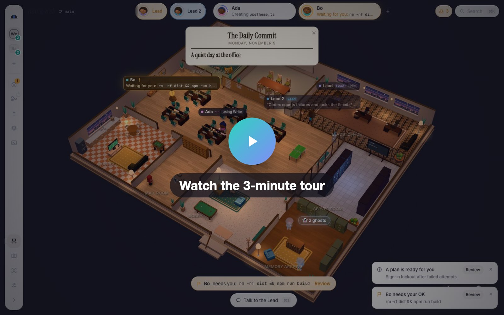
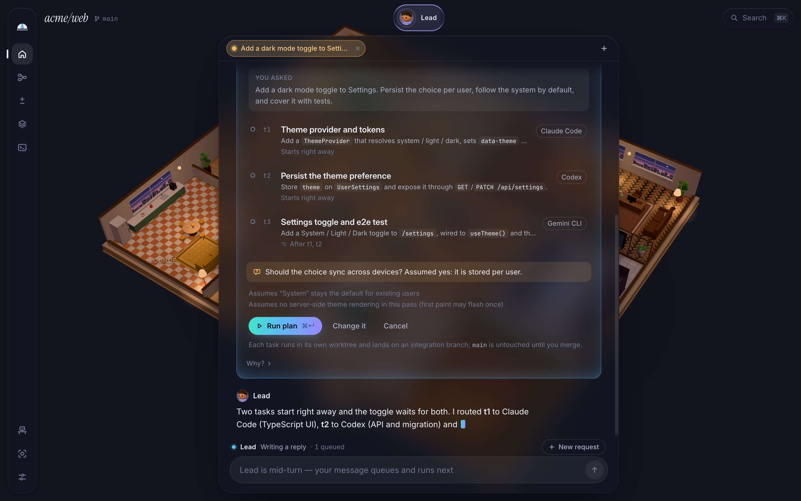
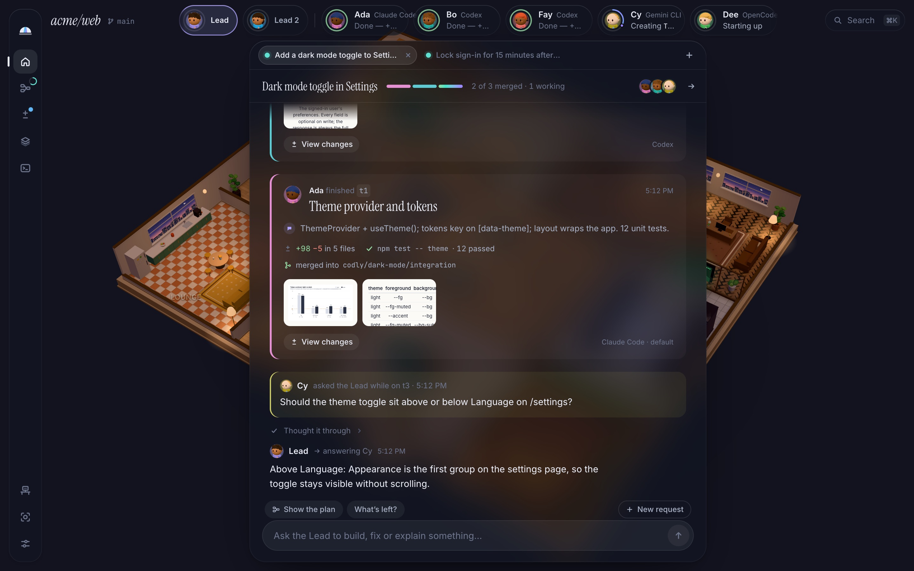

# Codly

**A team of coding agents, one living office.**

[](https://cdn.jsdelivr.net/gh/jwuthri-cloud/Codly@ed48fc5f4c9288d5e500d73756b29836b638e716/docs/media/codly-tour.mp4)

▶ [Watch the 3-minute tour](https://cdn.jsdelivr.net/gh/jwuthri-cloud/Codly@ed48fc5f4c9288d5e500d73756b29836b638e716/docs/media/codly-tour.mp4): ask the Lead, run its plan, approve, merge, and
start a long-term agent of your own.

Codly turns the coding CLIs you already pay for (Claude Code, Codex, Gemini CLI and OpenCode) into one
team on your Mac. A Lead agent plans the work, each agent builds in its own git worktree, and nothing
lands on your branch until you merge it. It is a macOS app built with Tauri, Svelte and Rust.


## Why

Running several coding agents in one repo gets messy fast. They step on each other's files, you lose
track of who is doing what, and every approval is a prompt in a separate terminal. Codly puts them
under one supervisor and shows the same events in two synchronized views:

- **Workspace**: chat with the Lead or talk 1:1 with any agent. Per-agent timeline, shared board, task
  dependency graph, diffs, terminals, and an approvals inbox.
- **World**: a three.js office. Agents walk to the library to search, to the server room to run tests,
  and raise a hand when they need you. Every motion comes from a real event.

## Screenshots

These come from the built-in demo: a fake `acme/web` repo with a scripted team.

### The Lead proposes a plan

Describe the goal to the Lead. It reads the repo read-only and either answers or proposes a small plan:
tasks, dependencies, the agent for each task, and any assumptions it made. You run it, change it or
cancel it.



### Follow the plan as it runs

The plan room lists every task with its checks and the files it may write. A task that depends on
another waits until that one is merged.


### Review finished work

Each finished task shows the verify command that ran, the size of the diff, and the integration branch it
merged into. Agents can ask the Lead a question mid-task, and the answer comes back into the thread.



### Approve what matters

Commands an agent wants to run arrive in one approvals inbox. Codly checks each request against its rules
first (here: it deletes files, stays inside the agent's worktree, and makes no network calls), then asks
you. Approve once, allow for the session, or deny.


## How it works

1. **Ask the Lead.** It reads the repo read-only and either answers or submits a task plan. Each request
   has a mode: Ask (answers only), Plan (you press Run plan), Auto (plans and runs) or Direct (hands the
   work straight to a team member or consultant). Tasks go to your standing team or to a consultant the
   Lead hires for one task.
2. **Validate and run.** Codly checks the plan for cycles and for two tasks writing the same files at once.
   You click **Run plan**.
3. **Work in isolation.** Each task runs in its own git worktree and branch. The worker gets a pointer pack
   of the relevant code and the team's memory.
4. **Land the work.** When a worker finishes, Codly commits, re-runs the verify commands, checks the write
   scope, optionally asks a reviewer from another vendor, and merges into the plan's integration branch.
   Agents never commit on their own.
5. **You merge.** Review the diff and merge it into your branch. Codly pushes your branch only when you
   press Push.

Agents coordinate through Codly's MCP tools, so every exchange is typed, validated and visible. Every
agent gets `codly_get_task`, `codly_board`, `codly_search`, `codly_memory_search`, `codly_memory_write`,
`codly_kg_query`, `codly_kg_add` and `codly_post_note`. The Lead adds `codly_submit_plan`,
`codly_message_member`, `codly_quick_task` and `codly_reassign`. Workers add `codly_submit_report` and
`codly_ask_lead`. Reviewers get `codly_submit_review`. The Lead and workers can also raise
`codly_ask_user` to ask you a decision.

## Supported agents

| Agent       | How Codly talks to it                                                                  |
| ----------- | -------------------------------------------------------------------------------------- |
| Claude Code | `claude` in stream-JSON mode, with the stdin control protocol for approvals and interrupts |
| Codex       | One `codex app-server` per agent (JSON-RPC over stdio): live command output, real approvals |
| Gemini CLI  | ACP (`gemini --acp`)                                                                   |
| OpenCode    | ACP (`opencode acp`)                                                                   |

Cursor and Copilot use the same ACP adapter, but they are less tested.

## First run

A short onboarding quest line checks which agent CLIs are installed, offers a visible "Run it for me"
install terminal for the missing ones, and walks you through setting up a Lead, a crew and a first
mission.

Approvals have four modes: balanced, strict, autonomous and Full access (auto-approves everything except
a few hard floors; off unless you choose it). Settings also holds Triggers (schedules and network mode)
and Inbound (webhook and Slack sources for the Lead).

## Requirements

- macOS 14 or later
- At least one agent CLI, installed and signed in
- To build from source: Rust 1.90+, Node 22+ and pnpm

## Getting started

```bash
pnpm install
pnpm tauri dev              # run the desktop app
```

Other useful commands:

```bash
pnpm dev                    # the UI alone in a browser, on a scripted demo session
pnpm test                   # frontend tests (Vitest)
pnpm check                  # svelte-check and TypeScript
cargo test --workspace      # core tests; adapters replay captured CLI transcripts
pnpm tauri build            # build the macOS app and .dmg
```

To use Codly from a browser instead of its window, run the app with `serve`:

```bash
/Applications/Codly.app/Contents/MacOS/codly serve   # prints a link with a token; --port N
```

It runs without a window or Dock icon until Ctrl+C. Run while the app is already open,
the open app serves too and opens the link in your browser.

`codly serve` listens on this Mac only (127.0.0.1). The page can open terminals and control your
agents, and the traffic is plain HTTP, so to reach it from another machine use an SSH tunnel:
`ssh -L 4280:127.0.0.1:4280 <this Mac>`, then open the link on that machine. `--host <address>`
with an address other machines can reach is refused unless you add `--allow-remote`; the link
then works for anyone on your network until Codly stops. Quit the app first: an app that is
already open does not serve to the network. `codly --help` lists every command and
`codly --version` prints the version.

## Develop

Before you push, run the checks that CI runs:

```bash
scripts/verify.sh           # pnpm check, pnpm test, pnpm build, cargo test --workspace
```

It also fails when the tests rewrite `src/lib/gen`: those TypeScript types are generated from the
Rust types by `cargo test`, so commit them with the change that needs them.

CI (`.github/workflows/ci.yml`) runs the same script on Linux for every pull request and every
push to `main`, and compiles the workspace on macOS. To run it on Linux yourself, install the
system packages the workflow lists.

## Troubleshooting

Settings → General → Troubleshooting collects what a bug report needs: the Codly version, your
system, your agent CLIs and the last log lines. Tokens, keys, email addresses and paths under your
home folder are taken out. Repository and agent names can remain: read it, then paste it in the
issue. The same button is on the “Codly couldn’t start” screen.

The log file is `~/Library/Application Support/dev.codly.desktop/logs/codly.log` (at most 5 MB;
the file before it is `codly.1.log`). An internal error (a panic) writes its place and backtrace
there. To log more, start Codly with `CODLY_LOG=debug`: the file then also takes Codly's own
debug lines (those of the libraries it uses go to the terminal only).

## Project layout

- `crates/codly-core/`: the engine, with no Tauri dependency. Orchestrator (Lead, team, planner, scheduler,
  merge queue, approval broker, triggers), agent adapters, SQLite store, git, code index, memory, inbound
  sources and the MCP server.
- `src-tauri/`: the macOS shell (Tauri 2) that hosts the engine, and `codly serve` (the same UI in a
  browser).
- `src/`: the Svelte 5 UI: the Workspace, the World (`src/office/`, three.js), the neighbourhood map
  (`src/world/`), Settings (`src/overlays/`) and onboarding.
- `public/`: the office's furniture models and sounds. These are third-party assets (CC0 and CC BY);
  each folder has its licence or credits file.
- `site/`: the landing page and the live demo build.
- `scripts/`: `install-app.sh` builds Codly.app and installs it in /Applications; `kaykit-clips.py`
  converts animation clips for the World.
- `voice/`: experimental and optional. A Python relay that lets you talk to an agent out loud through
  OpenAI Realtime, used only by `codly serve`. Its start script needs the author's own OpenAI workload
  identity, so nobody else can run it as it is. Without the relay everything else works; a voice call
  fails with "the voice relay is not running".
- `research-skills/`: optional skills for research work. They are not part of the app; you install them
  by hand with `research-skills/install.sh`.
- `docs/`: architecture, design notes and the research behind them.

The full code map is in [docs/ARCHITECTURE.md](docs/ARCHITECTURE.md), section 8.

## Subscriptions and safety

**Your sign-ins and keys**

- Codly spawns the unmodified CLIs you installed and signed in to. It does not proxy them. To see who is
  signed in, it runs the CLI's own status command (Claude Code, Codex) or reads the CLI's settings file
  (Gemini: the sign-in method and the account email, no token).
- Codly does not read your CLIs' sign-in tokens, with one exception that is off until you turn it on:
  **Show Claude usage before an agent runs** (Settings → Accounts). With it on, each time Codly checks
  your sign-ins it reads the Claude Code sign-in token (from the Keychain, or from the sign-in's
  `.credentials.json` file) and sends it to `api.anthropic.com` to ask for your usage, as `/usage` does.
  Codly does not store or log the token. Check Anthropic's terms first: they may not allow another app to
  use this token. With it off, a sign-in shows its usage once an agent has run on it.
- Keys that you give to Codly are stored in the macOS Keychain, not in Codly's settings or database: your
  own API keys (Settings → API keys; each one goes to one CLI only), the Groq key for dictation, webhook
  secrets and Slack tokens, and the keys of the tool servers you switch on for agents.
- Each agent shows a billing badge (subscription, API key or third party). API-key variables that would
  silently switch billing are removed from agent environments, unless you turned on your own API key for
  that vendor.

**Your repository**

- Codly commits and merges by itself only on its own `codly/…` branches: a task's branch, then the
  plan's integration branch after the task's checks pass.
- Codly changes your branch only when you press a button: **Merge** (a plan's integration branch, or one
  agent's branch, into the branch you have checked out), **Commit** (your own uncommitted changes) and
  **Push** (the branch you have checked out, to its remote, through your own SSH agent).
- One kind of agent edits your project folder directly: an agent that you hire with **Git isolation**
  switched off. The hire screen warns you about it.
- An agent that wants to run `git push` itself must ask you first, in every approval mode except Full
  access, which approves it.
- Codly removes a worktree only when it is clean and merged. It keeps the branch.

**The network**

- There are no Codly servers: no account, nothing to sync. Your CLIs talk to their own providers as
  before.
- Codly itself goes online only to install a CLI or a skill when you click, to fetch the tool servers
  that agents start with (through `npx` or `uvx`), to push when you press Push, and for two features that
  are off until you turn them on: dictation (audio goes to Groq with your key) and Show Claude usage.
  The voice relay in `voice/` talks to OpenAI, and only if you run it.
- Inbound webhooks listen on this Mac only (loopback) and are created switched off. `codly serve` also
  listens on this Mac only, unless you pass `--host`.

Provider terms change. Check them before heavy parallel use.

## Docs

- [Architecture](docs/ARCHITECTURE.md): decisions, processes, event model, orchestration and memory.
- [Research](docs/research/): the reports behind each decision, and the consolidated
  [critique](docs/research/CRITIQUE.md).

## Status

Early: this is the v0.1 vertical slice. Expect rough edges.
