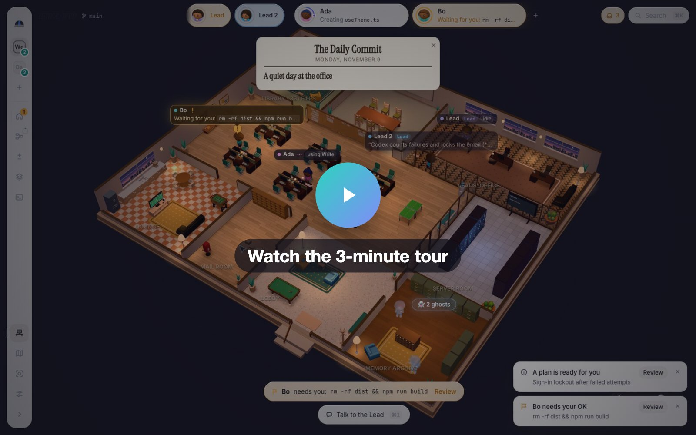
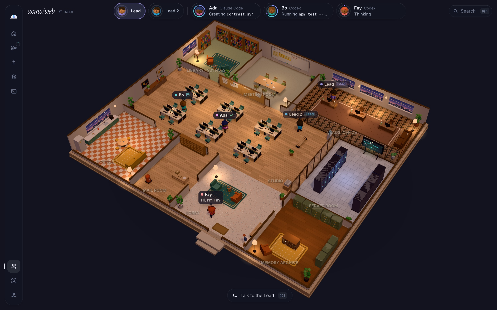
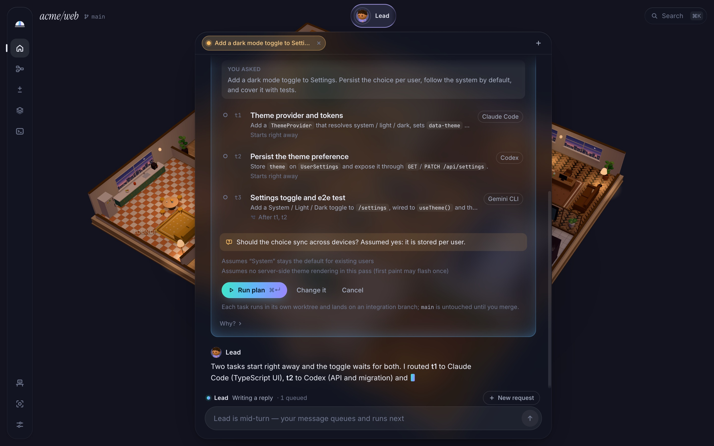
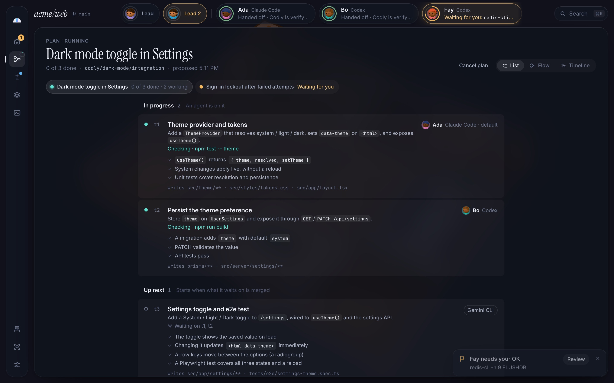
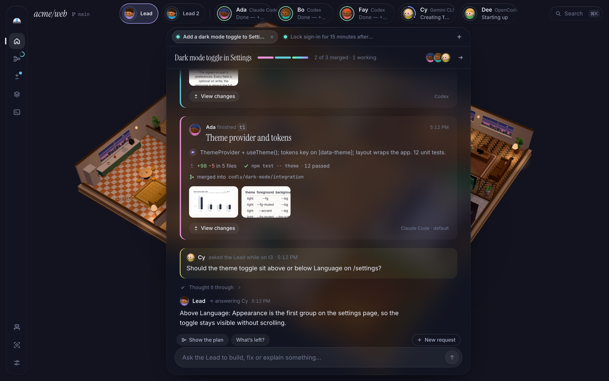
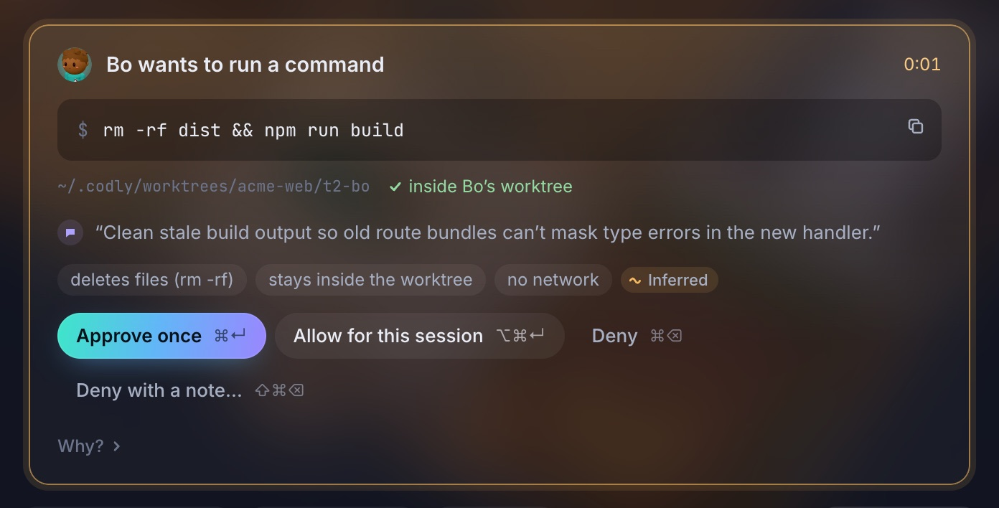

# Codly

**A team of coding agents, one living office.**

[](docs/media/codly-tour.mp4)

▶ [Watch the 3-minute tour](docs/media/codly-tour.mp4): ask the Lead, run its plan, approve, merge, and
start a long-term agent of your own.

Codly turns the coding CLIs you already pay for (Claude Code, Codex, Gemini CLI and OpenCode) into one
team on your Mac. A Lead agent plans the work, each agent builds in its own git worktree, and nothing
lands on your branch until you merge it. It is a macOS app built with Tauri, Svelte and Rust.



## Why

Running several coding agents in one repo gets messy fast. They step on each other's files, you lose
track of who is doing what, and every approval is a prompt in a separate terminal. Codly puts them
under one supervisor and shows the same events in two synchronized views:

- **Workspace**: chat with the Lead or talk 1:1 with any agent. Per-agent timeline, shared board, task
  dependency graph, diffs, terminals, and an approvals inbox.
- **World**: a three.js office. Agents walk to the library to search, to the server room to run tests,
  and raise a hand when they need you. Every motion comes from a real event.

## Screenshots

These come from the built-in demo: a fake `acme/web` repo with a scripted team.

### The Lead proposes a plan

Describe the goal to the Lead. It reads the repo read-only and either answers or proposes a small plan:
tasks, dependencies, the agent for each task, and any assumptions it made. You run it, change it or
cancel it.



### Follow the plan as it runs

The plan room lists every task with its checks and the files it may write. A task that depends on
another waits until that one is merged.



### Review finished work

Each finished task shows the verify command that ran, the size of the diff, and the integration branch it
merged into. Agents can ask the Lead a question mid-task, and the answer comes back into the thread.



### Approve what matters

Commands an agent wants to run arrive in one approvals inbox. Codly checks each request against its rules
first (here: it deletes files, stays inside the agent's worktree, and makes no network calls), then asks
you. Approve once, allow for the session, or deny.



## How it works

1. **Ask the Lead.** It reads the repo read-only and either answers or submits a task plan. Each request
   has a mode: Ask (answers only), Plan (you press Run plan), Auto (plans and runs) or Direct (hands the
   work straight to a team member or consultant). Tasks go to your standing team or to a consultant the
   Lead hires for one task.
2. **Validate and run.** Codly checks the plan for cycles and for two tasks writing the same files at once.
   You click **Run plan**.
3. **Work in isolation.** Each task runs in its own git worktree and branch. The worker gets a pointer pack
   of the relevant code and the team's memory.
4. **Land the work.** When a worker finishes, Codly commits, re-runs the verify commands, checks the write
   scope, optionally asks a reviewer from another vendor, and merges into the plan's integration branch.
   Agents never commit on their own.
5. **You merge.** Review the diff and merge it into your branch. Codly never pushes.

Agents coordinate through Codly's MCP tools, so every exchange is typed, validated and visible. Every
agent gets `codly_get_task`, `codly_board`, `codly_search`, `codly_memory_search`, `codly_memory_write`,
`codly_kg_query`, `codly_kg_add` and `codly_post_note`. The Lead adds `codly_submit_plan`,
`codly_message_member`, `codly_quick_task` and `codly_reassign`. Workers add `codly_submit_report` and
`codly_ask_lead`. Reviewers get `codly_submit_review`. The Lead and workers can also raise
`codly_ask_user` to ask you a decision.

## Supported agents

| Agent       | How Codly talks to it                                                                  |
| ----------- | -------------------------------------------------------------------------------------- |
| Claude Code | `claude` in stream-JSON mode, with the stdin control protocol for approvals and interrupts |
| Codex       | One `codex app-server` per agent (JSON-RPC over stdio): live command output, real approvals |
| Gemini CLI  | ACP (`gemini --acp`)                                                                   |
| OpenCode    | ACP (`opencode acp`)                                                                   |

Cursor and Copilot use the same ACP adapter, but they are less tested.

## First run

A short onboarding quest line checks which agent CLIs are installed, offers a visible "Run it for me"
install terminal for the missing ones, and walks you through setting up a Lead, a crew and a first
mission.

Approvals have four modes: balanced, strict, autonomous and Full access (auto-approves everything except
a few hard floors; off unless you choose it). Settings also holds Triggers (schedules and network mode)
and Inbound (webhook and Slack sources for the Lead).

## Requirements

- macOS 14 or later
- At least one agent CLI, installed and signed in
- To build from source: Rust 1.90+, Node 22+ and pnpm

## Getting started

```bash
pnpm install
pnpm tauri dev              # run the desktop app
```

Other useful commands:

```bash
pnpm dev                    # the UI alone in a browser, on a scripted demo session
pnpm test                   # frontend tests (Vitest)
pnpm check                  # svelte-check and TypeScript
cargo test --workspace      # core tests; adapters replay captured CLI transcripts
pnpm tauri build            # build the macOS app and .dmg
```

To use Codly from a browser instead of its window, run the app with `serve`:

```bash
/Applications/Codly.app/Contents/MacOS/codly serve   # prints a link with a token; --port, --host
```

It runs without a window or Dock icon until Ctrl+C. Run while the app is already open,
the open app serves too and opens the link in your browser.

## Project layout

- `crates/codly-core/`: the engine, with no Tauri dependency. Orchestrator (Lead, team, planner, scheduler,
  merge queue, approval broker, triggers), agent adapters, SQLite store, code index, memory, inbound
  sources and the MCP server.
- `src-tauri/`: the macOS shell (Tauri 2) that hosts the engine.
- `src/`: the Svelte 5 UI: the Workspace, the World (`src/office/`, three.js) and onboarding.
- `site/`: the landing page and the live demo build.
- `docs/`: architecture, design notes and the research behind them.

## Subscriptions and safety

- Codly spawns the unmodified CLIs you installed and signed in to. It never reads, stores or proxies your
  credentials.
- Each agent shows a billing badge (subscription, API key or third party). API-key variables that would
  silently switch billing are removed from agent environments.
- Codly never pushes, and it merges only into integration branches you review.
- Provider terms change. Check them before heavy parallel use.

## Docs

- [Architecture](docs/ARCHITECTURE.md): decisions, processes, event model, orchestration and memory.
- [Research](docs/research/): the reports behind each decision, and the consolidated
  [critique](docs/research/CRITIQUE.md).

## Status

Early: this is the v0.1 vertical slice. Expect rough edges.
